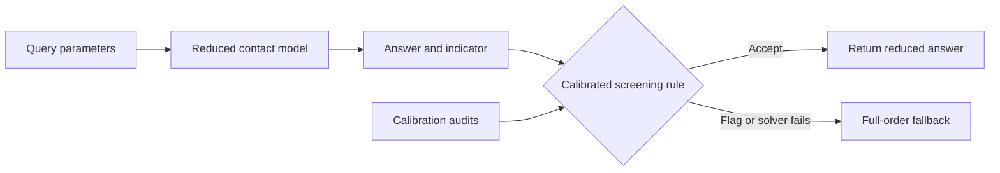

# Conformal Screening for Reduced Contact Models

[](https://www.python.org/)
[](https://numpy.org/)
[](https://scipy.org/)
[](LICENSE)

> **Can a reduced-order contact model detect when its answer is wrong before that answer is trusted?**
> This research project studies indicator-based screening with finite-sample guarantees on accepting silent failures.

The reduced model handles queries cheaply. A calibrated screen decides which answers are safe to accept and which should be sent to a full-order fallback. The experiments measure both the reliability of that decision and its computational cost.

## At a glance

| | |
|---|---|
| **Application** | Projection-based reduced models for static, frictionless contact |
| **Silent failure** | The reduced solver converges, but the energy error exceeds `EPS = 0.05` |
| **Screening signal** | An admissibility indicator computed from each reduced answer |
| **Main guarantee** | A class-conditional conformal threshold bounds the probability of missing a silent failure under exchangeability |
| **Full-order dependencies** | `fea_engine` and `rom_engine`, provided by the sibling `computation-suite` project |

## How it works



The screen flags an answer when the reduced solver fails or its indicator reaches the calibrated threshold. For the class-conditional rule, calibration uses the scores of silent failures; with exchangeable calibration and test failures and an indicator fixed independently of calibration, the rule controls the finite-sample miss rate. When there are too few calibration failures to define a useful threshold, the conservative rule flags every query.

The repository also evaluates weighted conformal thresholds, marginal risk control, cross-fitted rules, and a heuristic baseline. Guarantees and assumptions differ by method; see the descriptions in [`contactscreen/conformal.py`](contactscreen/conformal.py).

## Benchmarks

| Benchmark | Model | Preset |
|---|---|---|
| `membrane` | Membrane (`Quad4Laplace`) | `Membrane` |
| `block` | Elastic block (`Hex8Solid3D`) | `ElasticBlock` |
| `layered` | Layered elastic block (`Hex8Solid3D`) | `ElasticBlock` with layered material |

The benchmark presets, mesh sizes, and reduced-model settings are defined in [`contactscreen/config.py`](contactscreen/config.py).

## Get started

### Requirements

- Python 3.10 or later
- This repository and the sibling `computation-suite` repository containing `fea_engine` and `rom_engine`

The external solver packages are not vendored here. From this repository's root, create an environment and install the project and its dependencies:

```powershell
python -m venv .venv
.\.venv\Scripts\python -m pip install -r requirements.txt
.\.venv\Scripts\python -m pip install -e ..\..\computation-suite\fea_engine -e ..\..\computation-suite\rom_engine -e .
```

If `computation-suite` is checked out elsewhere, replace those two paths with the locations of its `fea_engine` and `rom_engine` packages.

### Run the tests

```powershell
.\.venv\Scripts\python -m pytest
```

### Reproduce an experiment

Generate full-order audit data first. This step can be computationally expensive.

```powershell
.\.venv\Scripts\python scripts\generate_audits.py --problem membrane --seeds 0-7
```

Then run a screening experiment:

```powershell
.\.venv\Scripts\python scripts\run_coverage.py --problem membrane
```

Other useful entry points:

| Script | Experiments | Purpose |
|---|---:|---|
| `run_coverage.py` | A, B, G | Coverage and calibration behavior |
| `run_outside.py` | C, G | Queries outside the training range |
| `run_fallback.py` | D, E | Fallback and timing comparison |
| `run_enriched.py` | F | Enriched calibration |
| `run_condensed.py` | H | Condensed full-order comparison |
| `generate_features.py`, `run_learned.py` | I | Learned screening rule |
| `run_learned_speedup.py` | J | Learned-rule speedup |
| `run_crossfit.py` | K | Cross-fitted screening |

Scripts accept `--help` for available options. For example, choose among `membrane`, `block`, and `layered` with `--problem`.

## Repository map

```text
contactscreen/   Solvers, reduced models, indicators, audits, and screening rules
scripts/         Audit generation and experiment command-line entry points
tests/           Unit and simulation tests
results/         Audit data and experiment outputs (JSON and NumPy archives)
```

## Notes on interpretation

- A **miss** is a silent failure not sent to the full-order fallback.
- A **flag** is a query sent to the fallback, either because the reduced solver failed or the indicator crossed the threshold.
- The class-conditional guarantee relies on exchangeability and an indicator fixed independently of the calibration queries. Results outside the calibration range are not covered by that assumption.
- Cross-fitted and heuristic methods are evaluated separately; do not interpret their measured performance as the class-conditional guarantee.

## License

This project is distributed under the [MIT License](LICENSE).
